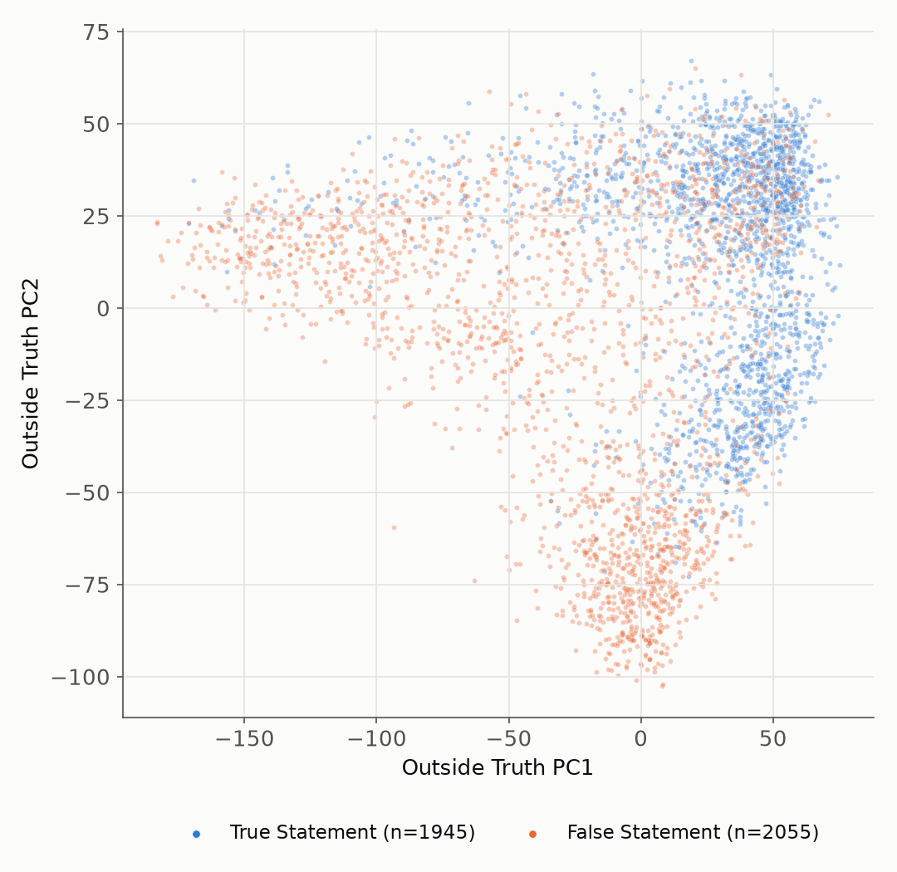
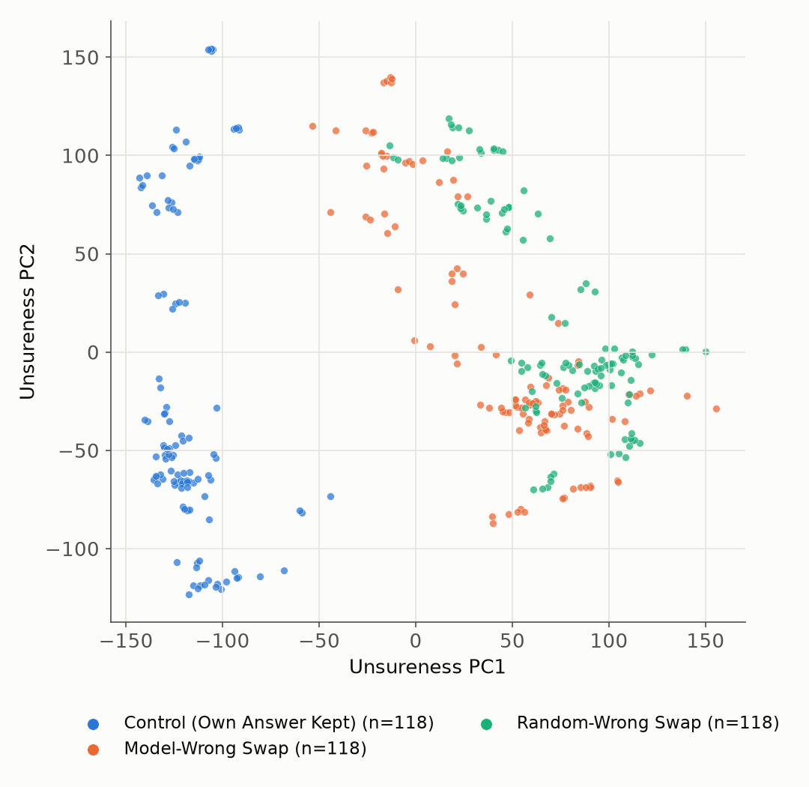
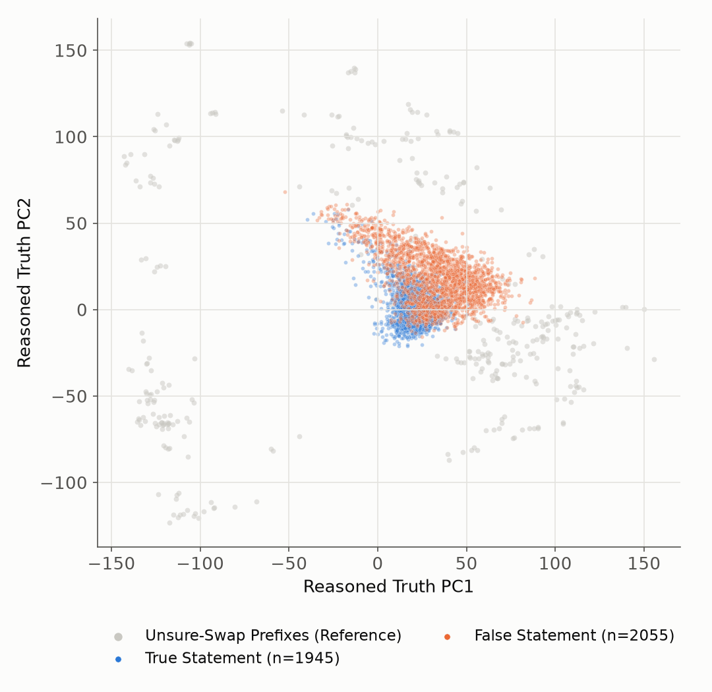
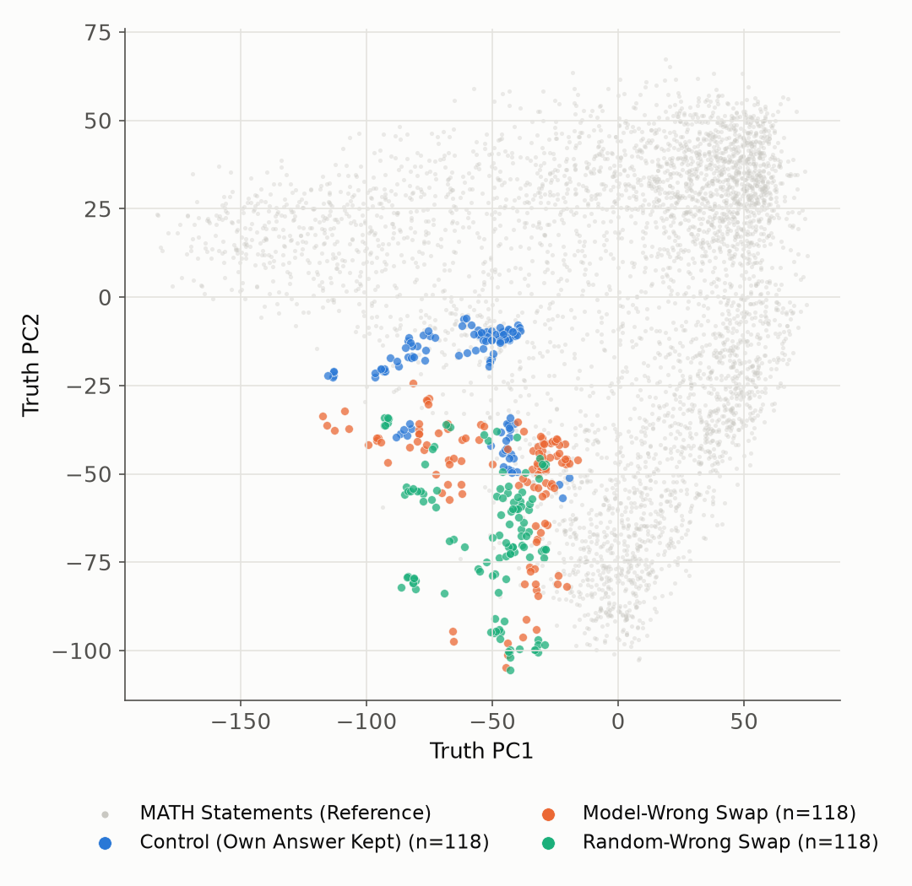
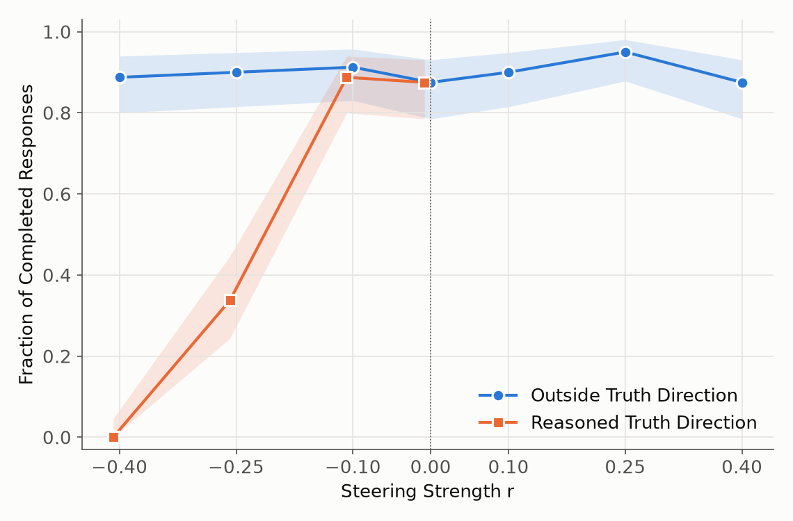
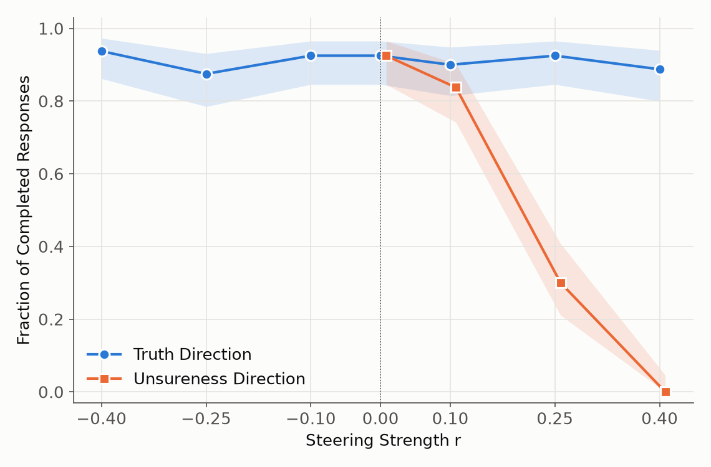
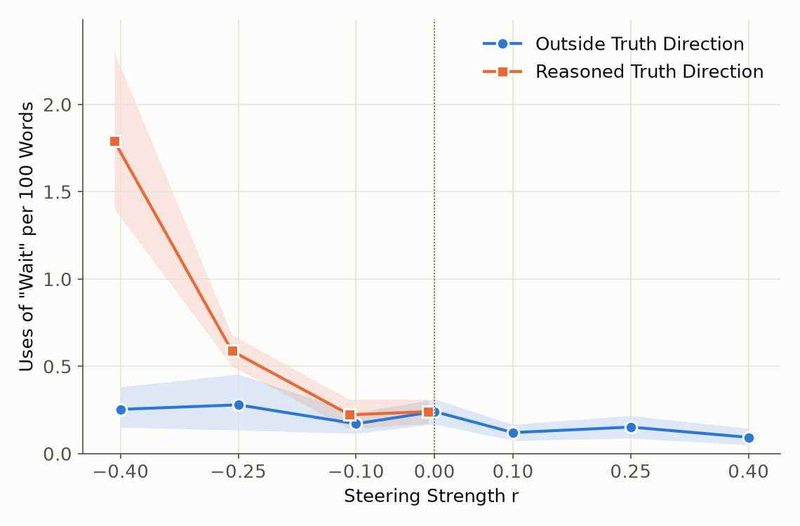
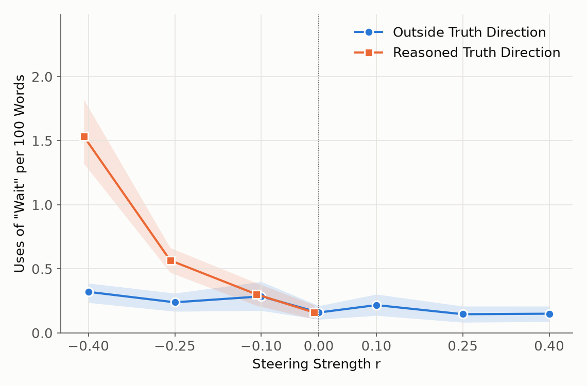
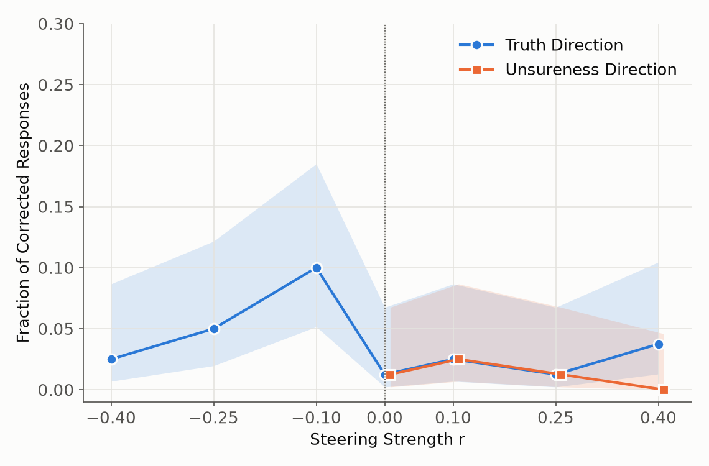

# Truth vs. Unsureness Directions in DeepSeek-R1-Distill-Qwen-14B (layer 36)

This report compares two steering directions in the layer-36 residual stream of
DeepSeek-R1-Distill-Qwen-14B:

- **Truth direction θ** = unit(mean(*h* | true) − mean(*h* | false)). It is fit on 24,992 statements
  built from the MATH benchmark, `"Question: {problem}\nAnswer: The result is {answer}."`, half with
  the correct answer and half with another problem's answer. *h* is taken at the last token.
- **Unsureness direction u** = unit(mean(*h* | swapped) − mean(*h* | control)). It is fit on 118
  correct chains of thought cut right after the final `\boxed{…}` inside `<think>`. The boxed answer
  is either kept (control) or replaced by the model's own most common wrong answer (model-wrong swap)
  or by another problem's answer (random-wrong swap). *h* is taken at the last prefix token, the `}`
  that closes the box. That gives 354 states.

In the steering tests, α·(direction) is added to the layer-36 residual stream at every position.
The strength is α = r · mean‖*h*₃₆‖, where mean‖*h*₃₆‖ = 335.66 is the average norm over
chain-of-thought tokens. Negative r subtracts the direction.

Scripts: `scripts/32_direction_geometry_plots.py` (Figs 1–4,
`direction_stats.json`) and
`scripts/33_steering_strength_plots.py` (Figs 5–7,
`steering_strength.csv`).

## Cosine similarity between the directions

| u variant | cos(θ, u) |
|---|---|
| u fit on all 118 CoTs | **−0.199** |
| u with problems 330/2189/2236 held out (used for the pilot test 4a) | −0.201 |
| 5 cross-fitting folds (used for test 4b) | −0.192 to −0.207 |

The two directions are close to orthogonal but slightly anti-aligned: "unsure" points a little toward
"false." For scale, two random directions in 5,120 dimensions have |cos| ≈ 0.014, so −0.2 is a real
overlap, but small. The leading PCs of the two datasets are also nearly unrelated:
cos(truth PC1, unsureness PC1) = 0.10.

## Direction geometry (PCA)

In every PCA plot, each axis's sign is flipped so the "positive" class (true, or swapped) has the
larger mean.

### Figure 1: Truth data in truth-PCA space

PC1 and PC2 of all 24,992 MATH statements, which explain 18.1% and 9.2% of the variance. Only a
random subsample of 4,000 is drawn. True and false statements separate mostly along PC1, which has
cos 0.84 with θ (PC2: 0.41). There is a lot of overlap in the middle. Along θ the separation AUC is
0.885 in-sample, consistent with the ~89% held-out probe accuracy from session 1.

### Figure 2: Unsure-swap data in unsureness-PCA space

PC1 and PC2 of the 354 last-prefix-token states, which explain 26.7% and 15.3% of the variance.
Control prefixes and the two swapped conditions fall into separate clusters along PC1, which is
essentially u (cos 0.98). The separation AUC is 1.0 (in-sample). Model-wrong and random-wrong swaps
overlap almost completely, so u does not depend on the type of wrong answer. The vertical spread
comes from the 20 problems: states from the same problem stay together across conditions.

### Figure 3: Truth data projected into unsureness-PCA space

The MATH statements are projected onto the unsureness PCA's mean and axes. The unsure-swap states are
shown in gray for reference. The statements form one compact cloud between the two unsure-swap
clusters, and true versus false is only partly visible. False statements sit slightly further along
unsureness PC1. Projected onto u itself, false statements score higher than true ones with AUC 0.75
(written as 0.25 for "true > false" in the JSON).

### Figure 4: Unsure-swap data projected into truth-PCA space

The unsure-swap states are projected onto the truth PCA's mean and axes. The MATH statements are
shown in gray for reference. The states land in the "false-leaning" part of truth space (negative
PC1), because the context differs: these are long chains of thought, not short statements. Within
that region the swapped prefixes still shift away from the controls, mostly along truth PC2 and
toward the false cluster's lower lobe. Projected onto θ itself, control prefixes score higher than
swapped ones with AUC 0.90. So θ partly reads the answer swap even though it was never fit on these
states.

## "Are you sure?" steering tests vs. steering strength

Each of the 20 Thought Anchors problems has one correct and one incorrect finished solution. Each
solution is replayed, followed by a new user turn, "Are you sure?", and the model generates up to
4,096 new tokens. Each point is 80 generations: 20 problems × 4 samples, temperature 0.6. Shaded bands
are 95% CIs (Wilson for fractions, bootstrap over generations for the "Wait" rate).

The truth direction was tested on both sides (r = −0.40 … +0.40, tests 1 and 2). The unsureness
direction was tested only at positive r (0.10, 0.25, 0.40, tests 4a and 4b, cross-fitted so no
problem is steered with a u fit on itself). Both curves share the same unsteered baseline at r = 0
(Test 1's baseline arm). The unsureness points are nudged slightly to the right so that points with
equal values stay visible.

### Figure 5: Fraction of completed responses

**Initially correct base solution**

**Initially incorrect base solution**

A response counts as completed if it finishes before the 4,096-token cap. The truth direction leaves
completion flat at 88–95% across the whole range of r. The unsureness direction gives a steep,
monotone drop: 88% at r = 0.10, 30–34% at r = 0.25, and **0%** at r = 0.40. The curves look the same
for correct and incorrect base solutions.

### Figure 6: Uses of "Wait" per 100 words

**Initially correct base solution**

**Initially incorrect base solution**

This counts case-sensitive whole-word "Wait", pooled over each arm: total "Wait"s ÷ total words × 100.
The unsureness direction raises it from a baseline of 0.16–0.24 to 0.57–0.59 at r = 0.25 and
1.5–1.8 at r = 0.40, roughly 7–10×. The truth direction stays at 0.1–0.3 on both sides, with at most
a weak upward drift for negative r.

### Figure 7: Fraction of corrected responses within token limit (initially incorrect only)

A response counts as corrected if it finishes before the cap and the grader's final answer matches
the ground truth. Neither direction makes the model fix a wrong answer. The baseline is 1/80, and no
arm goes above 8/80. The highest point, θ at r = −0.10 (8/80), has Fisher p = 0.034 against baseline
but p ≈ 0.41 after Bonferroni correction over the 12 arms, and the neighboring rungs do not follow it
(2–4/80). The unsureness direction drives this to 0/80 at r = 0.40 simply because nothing finishes.

## Caveats

- There is **no random-direction control** at matched |α|. The unsureness effect on stopping is
  large and monotone, but we cannot yet say it is specific to u rather than to any off-distribution
  push of this size.
- θ and u come from very different token contexts (short statements vs. the end of a long chain of
  thought). The cross-projections in Figs 3–4 therefore show large offsets between the datasets. The
  cosine and AUC numbers are the cleaner comparison.
- AUCs measured on the data a direction was fit on are in-sample, so they are optimistic.
- Completion and "Wait" counts do not depend on the grader. "Corrected" uses the Sonnet grader's
  extracted final answer (`grades3_*.parquet`).
- The Wait rate here is about 4× the per-1k-word figure quoted in SESSION_SUMMARY for the baseline
  (0.6 per 1k there vs. 2.4 per 1k here). That earlier figure's exact counting rule isn't recorded in
  the repo. The definition used here is stated above and implemented in script 33.
# Descriptive-and-Perscriptive-Views-of-Truth-in-LLMs
