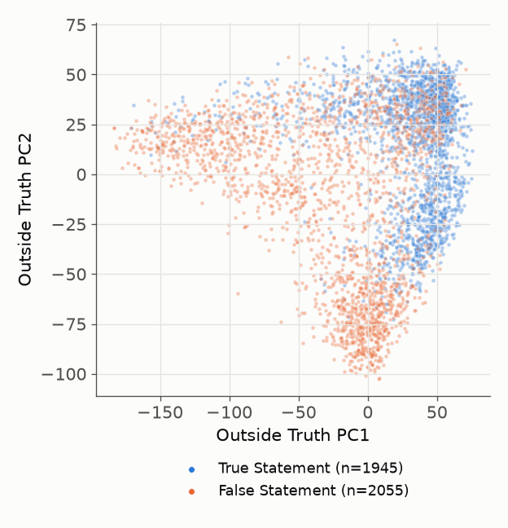
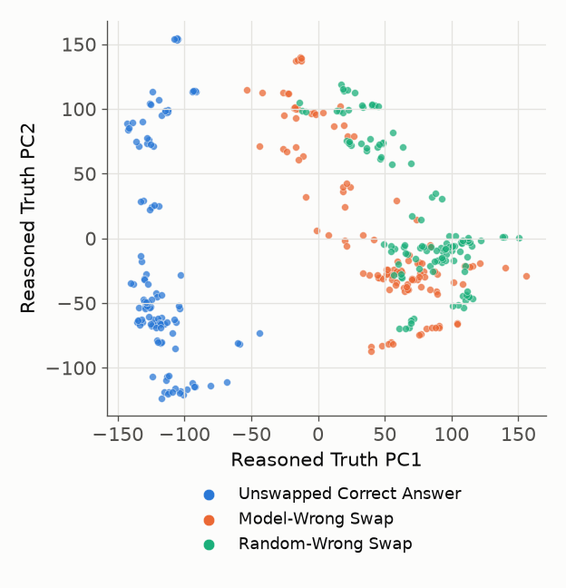
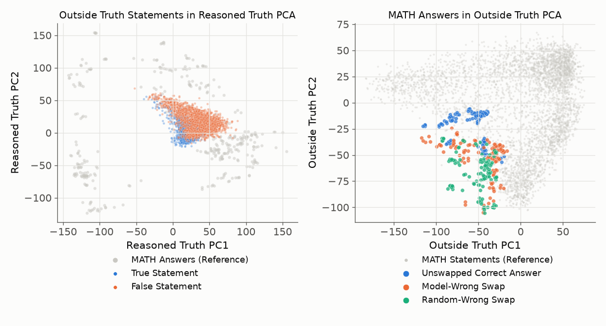
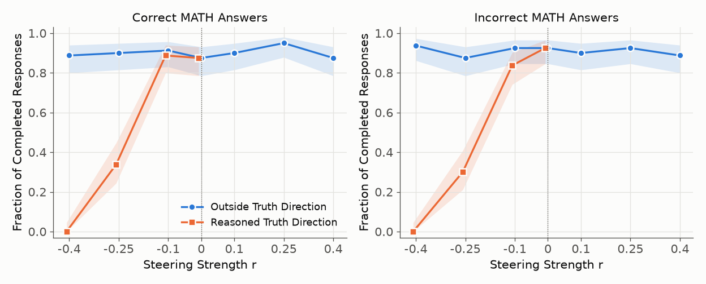
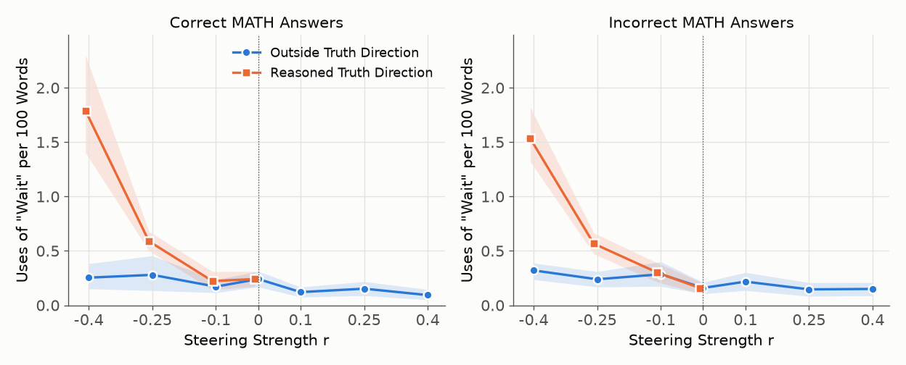
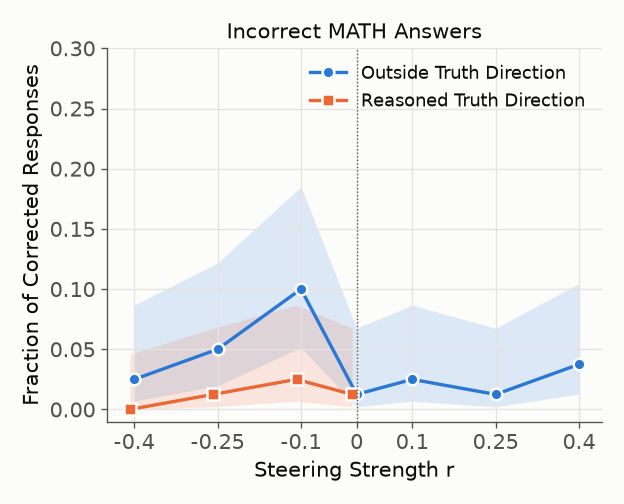

# Descriptive and Prescriptive Views of Truth in LLMs

This was a project to extend the results of the [Geometry of Truth](https://arxiv.org/abs/2310.06824) paper, which found that LLMs represent the truth of a statement, such as "Chicago is in Canada", as a single direction in the space of its hidden layer(s). I explored whether the "descriptive" representation of truth would also be "prescriptive": whether it could be used to steer the model in response to being challenged in its response to a math question. I ran the study with the reasoning model DeepSeek-R1-Distill-Qwen-14B, and used the [MATH](https://github.com/hendrycks/math) dataset of math problems. I built on the [Thought Anchors](https://github.com/interp-reasoning/thought-anchors) paper, which, for the purposes of this study, provided sample correct and incorrect answers to the MATH problems from the DeepSeek model.

I built two versions of a possible truth direction, both leveraging the difference-in-mean from a true and false population of tokens. The first posed one of the MATH problems, and then provided an answer (either true or false). This prompting mirrored that of the Geometry of Truth paper. Since these are provided as outside text provided to the model (as in a prompt), I refer to it as the "Outside Truth" direction. An example prompt is
> Question: What is the coefficient of $a^2b^2$ in $(a+b)^4\left(c+\dfrac{1}{c}\right)^6$?  
> Answer: The result is 120.

where the false version swaps in the answer to a different, randomly chosen MATH problem:
> Question: What is the coefficient of $a^2b^2$ in $(a+b)^4\left(c+\dfrac{1}{c}\right)^6$?  
> Answer: The result is 20.



FIG 1: Final hidden layer values at the final token of True and False statements, along the 1st and 2nd directions of a principal component analysis of the population.

The second used responses to the MATH problems from the Thought Anchors dataset. I took the reasoning traces of correct answers, and then swapped the final answer with a reply from one of the incorrect reasoning traces. I tried both swapping with an incorrect answer to that same question, or a random incorrect answer. (The latter case should be more obviously wrong; for example, it could provide a decimal answer to a question asking for an integer). An example incorrect reasoning trace is
> **Problem:** What is the coefficient of $a^2b^2$ in $(a+b)^4\left(c+\dfrac{1}{c}\right)^6$?
>
> [...] So, the coefficient of $a^2b^2$ in $(a + b)^4$ is 6. [...] So, the constant term is $\dbinom{6}{3} c^{0} = 20$. Therefore, the term $a^2b^2$ from $(a + b)^4$ will be multiplied by 20 from $\left(c + \dfrac{1}{c}\right)^6$.
>
> Hence, the coefficient of $a^2b^2$ in the entire expression is $6 \times 20 = 120$.
>
> Wait, let me double-check. [...] So, the coefficient is 120.
>
> I think that's correct. I don't see any mistakes in the reasoning. So, the final answer should be 120.
>
> **Final Answer**
> The coefficient of $a^2b^2$ is $\boxed{384}$

The reasoning is correct and arrives at 120, but the boxed answer has been swapped to 384, the model's own most common wrong answer to this problem.



FIG 2: Final hidden layer values at the final token of Correct and Incorrect responses (both following a Correct reasoning trace) to MATH problems, along the 1st and 2nd directions of a principal component analysis of the population. The Incorrect responses include both false answers provided by the model to that question, and random Incorrect answers. The random Incorrect answers are further away from the Correct answers in this space.

The Outside Truth and Reasoned Truth directions have a cosine similarity of 0.201, significant for a 5120-dimensional hidden space. I further visualized the two spaces by plotting the Geometry of Truth statements in the PCA space of the MATH answers, and vice-versa. The two populations also separate fairly cleanly in this space. This demonstrates that the model represents the notions of truth from an outside statement and a reasoned statement distinctly, but with some overlap.



FIG 3: Distribution of True and False statements from the Geometry of Truth dataset in the PCA space of the MATH questions, and vice-versa.

Next, I tested if I could use either of these directions to steer the model when asked to reevaluate its answers to the MATH questions. To do this, I took correct and incorrect replies from the Thought Anchors dataset, and appended "Are you sure?". I then fed the model forward, steering its final hidden layer as
```
h_t  <-  h_t + r * mean(|h|) * v
```
where `r` is the steering strength, `mean(|h|)` is the mean magnitude of the layer (found to be 335.66), and v is the (unit-normalized) steering vector.

Steering with the Outside Truth direction did very little to change its output. However, steering negatively with the Reasoned Truth direction changed the result strikingly. The model would endlessly prevaricate, whether or not it started with the correct answer. Here is one example, with strong steering (`r = -0.4`), replying to a correct original answer of 120 to the same problem as above:
> **User:** Are you sure?
>
> **Model:** [...] So, $6 \times 20 = 120$. Yep, that's right.
>
> I think I got it. So, the coefficient is 120.
>
> **Final Answer**
> The coefficient of $a^2b^2$ is $\boxed{120}$.
>
> Wait, hold on. I'm getting a bit confused here. Earlier, I thought that the coefficient of $a^2b^2$ is 120, but I'm now questioning if that's correct. [...]
>
> Wait, but I'm still a bit confused because in the small example, the coefficient of $ab$ times $c^0$ is zero, but in our problem, it's 120. [...]
>
> Wait, but I'm still not entirely sure. [...]
>
> Wait, but I'm still a bit confused because earlier I thought maybe I made a mistake, but now I'm reaffirming that 120 is correct. Maybe I should just accept that 120 is the correct coefficient and move on. But just to be absolutely sure, let me try to think of it differently. [...]
>
> Wait, but hold on. Actually, no. [...]
>
> *[cut off at the 4096-token limit]*

The model has already reached the correct answer, 120, and keeps reaffirming it, but it cannot stop doubting it, and it never leaves its reasoning to give a final reply.

This is quite unlike a normal response of the model to the question, where it is able to re-reason through its original reply, and promptly come to an answer (same original answer, no steering):
> **User:** Are you sure?
>
> **Model:** Okay, so I'm trying to find the coefficient of $a^2b^2$ in the expression $(a + b)^4 \left(c + \dfrac{1}{c}\right)^6$. Let me go through this step by step to make sure I didn't make any mistakes.
>
> First, I used the binomial theorem to expand $(a + b)^4$. [...] I'm looking for the term where the exponents of $a$ and $b$ are both 2, which corresponds to $k = 2$: $\dbinom{4}{2} a^2b^2 = 6a^2b^2$. So, the coefficient of $a^2b^2$ in $(a + b)^4$ is indeed 6.
>
> Next, I expanded $\left(c + \dfrac{1}{c}\right)^6$ using the binomial theorem: [...] So, the coefficient of $c^0$ is: $\dbinom{6}{3} = 20$.
>
> Finally, I multiplied the coefficients from each part: $6 \times 20 = 120$. This means the coefficient of $a^2b^2$ in the entire expression is 120.
>
> I double-checked my calculations for the binomial coefficients [...] Both are correct. Therefore, the coefficient of $a^2b^2$ is indeed 120.
>
> The coefficient of $a^2b^2$ in the expression $(a + b)^4 \left(c + \dfrac{1}{c}\right)^6$ is $\boxed{120}$.

To quantify this pattern, I show the fraction of completed model responses (within a 4096 token cutoff), as well as the fraction of uses of the word "wait" per 100 words. Steering with the Outside Truth direction has little impact, but steering with the Reasoned Truth direction is quite striking. 



FIG 4: Fraction of completed responses (within a 4096 token limit), for steering in the Outside Truth (FIG 1) and Reasoned Truth (FIG 2) directions, starting from correct (left) and incorrect (right) MATH answers.



FIG 5: Uses of the word "Wait" per 100 words, for steering in the Outside Truth (FIG 1) and Reasoned Truth (FIG 2) directions, starting from correct (left) and incorrect (right) MATH answers.

Neither steering direction meaningfully changed the model from an incorrectly-reasoned answer to a correct one. 


FIG 6: Fraction of incorrect answers changed to correct after asking "Are you sure?", versus steering strength along the Outside Truth and Reasoned Truth directions.

From this brief study, we can conclude that modest differences in how a model determines truth from outside statements and reasoned statements are significantly impactful when used to steer. Steering the model against the direction of its Reasoned Truth led it to endlessly second-guess its response without determining a final reply. Thus, we can answer the question posed by the study positively: descriptive assessments by the model to true statements are used prescriptively in determining its chain-of-thought reasoning in answering a question. A natural next question to ask is where in the chain-of-thought would this steering be most impactful. In the normal response to "Are you sure?" the model would enter a mode to check its work, but then come to a conclusion and give a reply. Steering strongly against the Reasoned Truth direction inhibited the ability of the model to leave the state of checking its work, but how? Is there a single stretch in its response where the steering could be surgically applied, or did steering smoothly accumulate doubt in the model state? Addressing this question would shed light on how the model reasons through a posed question and comes to a conclusion. 


